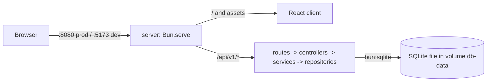

# Instant-Booking-SpecOps

A spec-driven foundation for an **instant booking** web app, built with [OpenSpec](https://github.com/Fission-AI/OpenSpec). Every behaviour is written as a numbered requirement (`RQ-…`) before it is coded, and every requirement has a test named after it.

> **Status: the technical foundation is complete; the booking features are not built yet.** The app runs, serves a placeholder page and exposes health endpoints. Instant booking itself is waiting for its business rules. See [What remains](#what-remains).

## What is built

| Area | What works today |
|------|------------------|
| Runtime | One Bun 1.4.2 server that serves the API and the web client from the same origin |
| Database | SQLite (`bun:sqlite`, WAL mode) in a Docker volume, with forward-only SQL migrations applied at startup, exactly once even when several processes start together |
| API | `GET /api/v1/health` (liveness) and `GET /api/v1/ready` (readiness), a standard error format, request IDs, security headers, CORS allowlist, 100 kB body limit, JSON logs without personal data |
| Client | React shell with a header, main area and an error screen with a reload button; WCAG 2.1 AA, mobile-first from 360 px, 65 kB of JavaScript gzipped |
| Operations | `docker compose up` for dev and prod, healthcheck, clean shutdown on SIGTERM, multi-arch image (amd64 + arm64), non-root container |
| Quality gates | Typecheck, lint with layering rules, 87 unit and integration tests, coverage thresholds, API contract check (oasdiff), bundle-size check, 8 browser tests with axe, Docker smoke test, performance check |

## Tech stack

- **Server:** Bun 1.4.2, `Bun.serve`, TypeScript 6, Zod 4, SQLite via `bun:sqlite`
- **Client:** React 19, TypeScript, Bun bundler, one plain CSS stylesheet
- **Shared:** Zod schemas used by both sides, plus an OpenAPI 3.1 document generated from them
- **Tests:** `bun test`, React Testing Library on happy-dom, Playwright + axe (in Docker), autocannon
- **Ops:** Docker Compose, `oven/bun:1.4.2-alpine`

## Quick start

Prerequisites: [Bun 1.4.2](https://bun.sh) and Docker Desktop.

```bash
bun install
cp .env.example .env            # Windows: copy .env.example .env
```

| Goal | Command | Open |
|------|---------|------|
| Prod mode in Docker | `docker compose -f compose.yaml -f compose.prod.yaml up --build` | http://localhost:8080 |
| Dev mode in Docker | `docker compose up --build` | http://localhost:5173 |
| Dev with hot reload (recommended on Windows/macOS) | `bun run dev` | http://localhost:5173 |
| Reset the database | `docker compose down -v` | |

If a port is taken, set `WEB_DEV_PORT` or `WEB_PROD_PORT` in `.env`.

## Commands

| Command | What it does |
|---------|--------------|
| `bun run check` | Everything below that needs no running stack: typecheck, lint, tests with coverage, contract check, bundle check |
| `bun run test` | `bun test` in every workspace (no Docker needed) |
| `bun run contract:check` | Fails if the generated OpenAPI document breaks `shared/openapi/openapi.json` (needs Docker) |
| `bun run contract:update` | Writes the new baseline after a non-breaking API change |
| `bun run smoke:compose` | Docker smoke test of both modes, persistence, reset and shutdown (deletes the local volume) |
| `bun run test:e2e` | Playwright + axe in its Docker image against the prod stack |
| `bun run test:perf` | autocannon against the running prod stack (p95 must stay under 500 ms) |

## Architecture



```
shared/   Zod schemas, OpenAPI builder, committed contract baseline (openapi/openapi.json)
server/   config, logging, errors, http (request ID, CORS, security headers, body limit, static files),
          routes -> controllers -> services -> repositories / providers, lifecycle, migrations/
client/   index.html, src/app, src/components, src/strings (all UI text), src/styles.css
scripts/  contract check, Docker smoke test, performance check
e2e/      Playwright + axe tests and their Dockerfile
openspec/ config.yaml (engineering guardrails), specs/ (current requirements), changes/ (proposals, archive)
```

Calls only go down the layers; ESLint enforces this. SQL lives only in `server/src/repositories/`. Full detail, diagrams and decisions are in [project.md](project.md).

### API

| Method | Path | Success | Errors |
|--------|------|---------|--------|
| GET | `/api/v1/health` | 200 `{"status":"ok"}` | none |
| GET | `/api/v1/ready` | 200 `{"status":"ready"}` | 503 `DATABASE_UNAVAILABLE`, `SHUTTING_DOWN` |
| any | other `/api/v1/*` | none | 404 `NOT_FOUND`, 400 `INVALID_JSON`, 413 `PAYLOAD_TOO_LARGE`, 500 `INTERNAL_ERROR` |

Every error has the shape `{"error":{"code","message","requestId"}}`, and every response carries `X-Request-Id`.

### Configuration

All variables are validated at startup and listed in [.env.example](.env.example). The server refuses to start, naming the bad variable but never its value, when one is missing or invalid.

| Variable | Default | Purpose |
|----------|---------|---------|
| `DATABASE_PATH` | required (`/data/app.db` in Docker) | SQLite file |
| `PORT` | 3000 | Port inside the container |
| `NODE_ENV` | `production` | `development` enables hot reload |
| `LOG_LEVEL` | `info` | `debug`, `info`, `warn`, `error` |
| `CORS_ORIGINS` | empty | Comma-separated origins allowed cross-origin |
| `BODY_LIMIT_BYTES` | 102400 | Request body limit |
| `READY_DB_TIMEOUT_MS` | 2000 | Readiness database timeout |
| `SHUTDOWN_GRACE_MS` | 10000 | Time in-flight requests get on shutdown |

## How this project is built (OpenSpec)

1. **Guardrails** in [openspec/config.yaml](openspec/config.yaml) say *how* to build: stack, layering, testing, security, backward compatibility. Business rules live only in [scope.md](scope.md).
2. **Propose:** each change gets a proposal, delta specs (GIVEN/WHEN/THEN scenarios), a design and a task list under `openspec/changes/<name>/`.
3. **Apply:** tasks are implemented in order, each with a concrete done check.
4. **Archive:** verified changes merge their specs into [openspec/specs/](openspec/specs) and move to `openspec/changes/archive/`.

Completed changes:

- `2026-11-17-setup-project-foundation`: Node + Express + PostgreSQL foundation, 22 requirements
- `2026-11-17-migrate-to-bun-sqlite`: move to Bun + SQLite, single server, simpler client

Living docs, updated in every session:

- [project.md](project.md): how to run, architecture
- [scope.md](scope.md): requirement register
- [context.md](context.md): focus, open items, decisions
- [history.md](history.md): change log

## What remains

The app is **not feature-complete**. Remaining work, in priority order:

1. **Instant booking features (blocked).** The change `openspec/changes/add-instant-booking` is an empty scaffold. It needs business input in [scope.md](scope.md) first:
   - who books what
   - how instant booking differs from a normal booking
   - availability and double-booking rules
   - prices and limits
   - the user flow
2. **Product name.** The UI shows the placeholder "Untitled product" (`client/src/strings/en.ts`).
3. **Markets in scope:** locales, currencies, time zones and privacy laws (e.g. GDPR, India's DPDP Act). These are needed before any user data or formatting work.
4. **Built with the first endpoint that needs them**, deliberately not earlier:
   - Idempotency-Key storage for create endpoints
   - rate limits on write endpoints
   - request-body Zod validation
   - the client API layer with loading, empty and error states
5. **Continuous integration.** No CI pipeline yet; `bun run check`, `smoke:compose` and `test:e2e` currently run locally.
6. **Spec wording.** The `service-lifecycle` spec's Purpose still mentions scaling, which no longer applies to a single server.

## Known limitations

- **Single server instance.** SQLite has one writer per file, so the API scales vertically only (decided 2026-11-17).
- **No hot reload in Docker on Windows/macOS hosts.** Bun's file watcher cannot see changes through Docker bind mounts on these hosts. Use `bun run dev` on the host instead.
- **The SQLite driver is synchronous.** A lock held by another process can stall the main connection for up to `READY_DB_TIMEOUT_MS`; readiness uses its own non-blocking connection.
