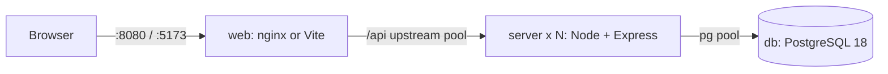
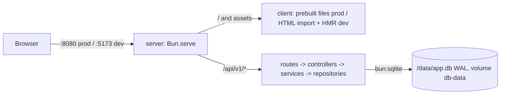
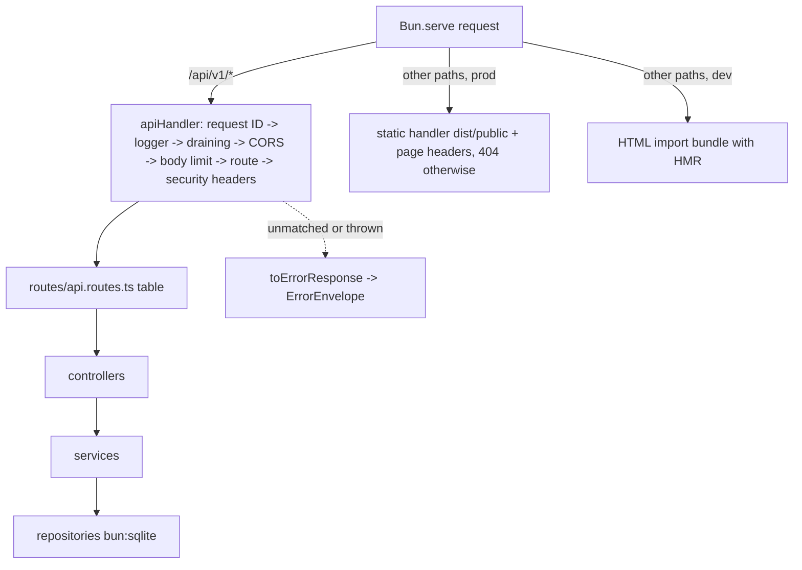

# Design

## Context

The archived foundation runs Node 22 + Express + PostgreSQL behind an nginx `web` container, with Vite, CSS Modules, Vitest, jsdom, Supertest and tsx as tooling (see `project.md`). The user decided on 2026-11-17: Bun backend, SQLite, single server, the server serves the client, plain CSS and fewer tools (proposal.md, Why). The HTTP contract (`shared/openapi/openapi.json`) must not change. Bun 1.4.2 is installed on the dev machine; Node 22.22.0 stays installed but is no longer needed for the project.

## Goals / Non-Goals

**Goals:**
- One runtime (Bun) for server, client build, scripts and unit/integration tests; Docker is the only other host requirement.
- One container (`server`) that owns the SQLite file and serves the client and the API.
- Keep the layering, error hierarchy, logger, config schema and shared Zod schemas; replace only what depends on Node, Express, PostgreSQL, nginx or Vite.

**Non-Goals:**
- Changing any API path, body, status, error code or API header.
- Restoring horizontal scaling or a networked database.
- Replacing React, ESLint, TypeScript or Playwright.

## Architecture

### Before



### After



### Request pipeline (RQ-API-001 to RQ-API-007, RQ-WEB-001, RQ-WEB-005)



## Decisions

### D1. `Bun.serve` instead of Express (RQ-API-001 to RQ-API-007)

`server/src/app.ts` exports `createApp(deps)` returning `{ fetch(request): Promise<Response> }` plus the `routes` object for `Bun.serve`. Express middleware becomes small composable functions over `Request`/`Response`:

| Express piece | Replacement |
|---------------|-------------|
| `requestId()` | `resolveRequestId()` (unchanged) + header set on the final response |
| `requestLogger()` | `logRequest()` after the response is built (method, path without query, status, duration) |
| `helmet()` | `apiSecurityHeaders` constant map: nosniff, HSTS, `Content-Security-Policy: default-src 'none'`, plus the other helmet defaults already sent today |
| `cors()` | `corsHeaders(origin, allowlist)`; preflight `OPTIONS` answered 204 only for allowed origins |
| `express.json({ limit })` | `readJsonBody(request, limitBytes)`: 413 from `Content-Length` before reading, else counts streamed bytes; `INVALID_JSON` on parse failure |
| `notFound` / `errorHandler` | `toErrorResponse(error, requestId, logger)` using the unchanged `AppError` hierarchy |

Unknown methods on known paths fall through to the 404 handler, as today. Alternative kept-Express-on-Bun was rejected: it keeps express, helmet and cors and cannot use Bun HTML imports for the client. `Bun.serve` `maxRequestBodySize` is set to `BODY_LIMIT_BYTES` + 1 MiB as a hard backstop only.

### D2. Shared package without a build step (RQ-API-008)

Bun and TypeScript (`moduleResolution: Bundler`) both read TypeScript source, so `shared/package.json` exports `./src/index.ts` directly and the `dist` build, `tsconfig.build.json` and the `source` condition are removed. Schemas, route table and OpenAPI builder are unchanged, so `contract:check` must report no changes.

### D3. SQLite access (RQ-OPS-002, RQ-OPS-003, RQ-OPS-010)

`providers/database.provider.ts` opens `new Database(DATABASE_PATH, { create: true, strict: true })` after `mkdirSync(dirname(path), { recursive: true })`, then runs `PRAGMA journal_mode = WAL; PRAGMA busy_timeout = <READY_DB_TIMEOUT_MS>; PRAGMA foreign_keys = ON; PRAGMA synchronous = NORMAL`. An unwritable directory throws, and `main.ts` logs it and exits 1 (RQ-OPS-007 "Database never becomes healthy"). Config: `DATABASE_URL` is replaced by required `DATABASE_PATH` (Compose sets `/data/app.db`); all other variables keep their names and defaults.

### D4. Migrations with immediate transactions (RQ-OPS-004 to RQ-OPS-006)

```sql
CREATE TABLE IF NOT EXISTS schema_migrations (
  name       TEXT PRIMARY KEY,
  checksum   TEXT NOT NULL CHECK (length(checksum) = 64),
  applied_at TEXT NOT NULL DEFAULT (strftime('%Y-%m-%dT%H:%M:%fZ', 'now'))
) STRICT;
```

`MigrationRepository.inWriteTransaction(work)` runs `work` inside `db.transaction(fn).immediate()`. `runMigrations` loops: open an immediate transaction, ensure the table, list applied rows, verify checksums and missing files (unchanged `MigrationError` codes), apply the first pending file and record it, commit; repeat until nothing is pending. Each file therefore gets its own transaction (RQ-OPS-004), and the check-then-apply happens under one write lock, so concurrent processes apply each file exactly once (RQ-OPS-006). A killed process leaves an uncommitted transaction that SQLite rolls back from the WAL on the next open. The advisory-lock module `lock-keys.ts` is deleted. `0001_baseline.sql` (`SELECT 1;`) is unchanged; its checksum is unchanged, but the database is new, so it is applied again.

### D5. Readiness on SQLite (RQ-OPS-001, RQ-OPS-002)

`SqliteDatabaseHealthRepository.ping()` runs `SELECT count(*) FROM schema_migrations` on a dedicated connection opened with `busy_timeout = 0`. On `SQLITE_BUSY` it retries every 25 ms with `Bun.sleep` until `READY_DB_TIMEOUT_MS`, then rejects, which becomes 503 `DATABASE_UNAVAILABLE`. `HealthService` is unchanged (lifecycle flag + `withTimeout`). Liveness never queries the database.

Changed during implementation: relying on SQLite's own `busy_timeout` overshot badly on Windows (a 2000 ms timeout waited 3186 ms), breaking the "timeout + 500 ms" bound, and blocked the event loop while waiting. Statements are not prepared once, because a prepared statement keeps answering after its connection is closed and would hide an unreachable database.

### D6. Serving the client (RQ-WEB-001, RQ-WEB-004, RQ-WEB-005)

- **Dev** (`NODE_ENV=development`): `main.ts` dynamically imports `client/index.html` and passes it as the `/` route with `development: { hmr: true }`, so Bun bundles React, TSX and CSS with hot reload. No CSP is applied to dev pages (the HMR client needs a WebSocket).
- **Prod**: the Docker build runs `bun build client/index.html --outdir dist/public --production`. A `serveStatic(publicDir)` handler serves files with the page headers from RQ-WEB-005, rejects paths that resolve outside `publicDir`, and returns 404 for anything missing.
- Client: CSS Modules are replaced by one `client/src/styles.css` linked from `index.html`; components use plain class names. The `%APP_TITLE%` Vite plugin is removed: `index.html` keeps an empty `<title>`, and `main.tsx` sets `document.title = strings.app.name` before the first render, so no UI text lives in HTML.
- `check-bundle` reads the built `index.html`, follows its module scripts and fails at 200 kB gzipped or more.

### D7. Tests on `bun test` (all RQ IDs)

- `bun test` replaces Vitest; each workspace has a `bunfig.toml` with its coverage threshold (server and shared 0.8, client 0.7), so the per-package gates remain.
- Integration tests use a fresh temporary SQLite file per test file (`createTestDatabase()` in `server/test/database.ts`), so they no longer need Docker. The concurrency tests (RQ-OPS-006) spawn 10 Bun subprocesses with `Bun.spawn` running `server/test/run-migrations.ts`; the kill test terminates a subprocess that holds an immediate transaction.
- HTTP tests call `app.fetch(new Request(...))` directly instead of Supertest; the shutdown test starts a real `Bun.serve` on port 0.
- Client tests use `@happy-dom/global-registrator` (preload) with React Testing Library, user-event and the jest-dom matchers via `expect.extend`.
- Fake timers: use `bun:test` fake timers if 1.4.2 supports them; otherwise inject a 20 ms timeout.

### D8. Docker (RQ-OPS-007, RQ-OPS-008, RQ-OPS-010)

- One `server/Dockerfile` on `oven/bun:1.4.2-alpine` (multi-arch): `deps` (`bun install --frozen-lockfile`), `dev` (`bun --watch server/src/main.ts`, bind mounts for `server/src`, `shared/src`, `client`), `build` (client bundle), `runtime` (production deps, `server/src`, `shared/src`, `server/migrations`, `dist/public`; `USER bun`; `CMD ["bun", "server/src/main.ts"]`).
- `RUN mkdir -p /data && chown bun:bun /data` so the named volume `db-data:/data` is writable by the non-root user on first mount.
- Compose: services `server` only; container port 3000; host `${WEB_DEV_PORT:-5173}:3000` (dev) and `${WEB_PROD_PORT:-8080}:3000` (prod); `init: true`, `stop_grace_period: 15s`; healthcheck `wget -qO /dev/null http://127.0.0.1:3000/api/v1/ready`. Image tags stay per mode (`app-server:dev`, `app-server:prod`).
- Removed: `db` and `web` services, `client/Dockerfile`, `client/nginx.conf`, `DB_HOST_PORT`, `TEST_DATABASE_URL`, `POSTGRES_*`.

### D9. End-to-end and performance tooling

Playwright's test runner is not supported on Bun, so `e2e/` becomes its own small package (exact versions of `@playwright/test`, `@axe-core/playwright`, `typescript`) built into `e2e/Dockerfile` from `mcr.microsoft.com/playwright:v1.65.1-noble`. It runs as a Compose service under profile `e2e` against `http://server:3000`: `docker compose -f compose.yaml -f compose.prod.yaml --profile e2e run --rm e2e`. autocannon runs on Bun from `scripts/perf.ts`; if it misbehaves on Bun, the same script runs inside the Playwright image, which has Node.

### D10. Stack config and tooling

`openspec/config.yaml` is edited in place (the user approved the stack change): section 2 (Bun 1.4.2, `Bun.serve`, `bun:sqlite`, React + TypeScript + Bun bundler + plain CSS, Bun workspaces), section 3 (one `server` service, SQLite volume, ports, no web/db services), section 4 (drop the `--scale` line; the server stays stateless), section 6 (idempotency keys "in the database"), section 10 (`bun test` + React Testing Library + happy-dom; integration on a fresh SQLite file; concurrency with N parallel processes), and the header decision line (DB = SQLite). Lint and typecheck run with `bun --bun eslint` and `bun --bun tsc`. `.nvmrc` and `.npmrc` are replaced by `"packageManager": "bun@1.4.2"` and `bunfig.toml`; `package-lock.json` by `bun.lock`.

### Dependencies

| Change | Package | Why |
|--------|---------|-----|
| Remove | express, helmet, cors, pg, @types/express, @types/cors, @types/pg | Replaced by `Bun.serve`, small header helpers and `bun:sqlite` |
| Remove | vite, @vitejs/plugin-react | Bun bundles the client |
| Remove | vitest, @vitest/coverage-v8, jsdom, supertest, @types/supertest, tsx, @types/node | `bun test`, happy-dom, `app.fetch`, Bun runs TypeScript |
| Add | @types/bun 1.4.2 | Bun runtime types |
| Add | happy-dom, @happy-dom/global-registrator 21.0.4 | DOM for client tests; the setup Bun documents |
| Keep | zod, react, react-dom, @testing-library/react, @testing-library/user-event, @testing-library/jest-dom, @testing-library/dom, eslint, @eslint/js, typescript-eslint, globals, typescript 6.0.3, autocannon | Unchanged roles |
| Move | @playwright/test, @axe-core/playwright | Into `e2e/package.json`, run in the Playwright image |

## Backward compatibility

API: unchanged; `contract:check` must report "No changes detected", and every `api-conventions` test runs unchanged in behaviour against `app.fetch`. Operational breaks (approved by the user): `DATABASE_URL` becomes `DATABASE_PATH`, the `db` and `web` services disappear, `--scale` is unsupported, and the client is served by `server`. No business data exists; the old PostgreSQL volume is removed with `docker compose down -v` before switching.

## Docker impact

From three services (db, server ×N, web) to one (`server`). Images: `oven/bun:1.4.2-alpine` (server), `mcr.microsoft.com/playwright:v1.65.1-noble` (e2e profile only), `tufin/oasdiff:v1.38.0` (contract check). Removed: `postgres:18.7-alpine3.24`, `nginxinc/nginx-unprivileged:1.31.7-alpine3.24`, `node:22.22.0-alpine3.23`. Volume `db-data` now holds `/data/app.db`, `app.db-wal` and `app.db-shm`.

## Test plan

Unchanged requirements keep their existing tests, ported to `bun test`. Changed and new ones:

| RQ ID | Level | Test |
|-------|-------|------|
| RQ-OPS-001 | Integration | 200 ok on a fresh SQLite file; still 200 with a closed database connection |
| RQ-OPS-002 | Integration + unit | 200 ready after migrations; 503 `DATABASE_UNAVAILABLE` with a closed connection; 503 within timeout + 500 ms while another connection holds an exclusive lock; 503 `SHUTTING_DOWN` |
| RQ-OPS-003 | Unit | Missing `DATABASE_PATH` is `required`; bad `BODY_LIMIT_BYTES` named without its value or the path; `.env.example` complete |
| RQ-OPS-006 | Concurrency | 10 `Bun.spawn` runs on one file: one execution, one row, all exit 0; killed lock holder leaves nothing recorded and the next run applies |
| RQ-OPS-007 | Docker smoke | Dev and prod from `down -v`: `server` healthy, shell served on 5173/8080; read-only `/data` makes the server exit non-zero and stay unhealthy |
| RQ-OPS-008 | Unit + Docker smoke | In-process shutdown on `Bun.serve` (exit 0 after in-flight; exit 1 within 1500 ms); `docker compose stop server` exits 0 |
| RQ-OPS-010 | Docker smoke | `down`/`up` keeps `schema_migrations` rows; `down -v` re-applies |
| RQ-WEB-001 | Component + e2e | Banner and main by role; no console errors; `/assets/missing.js` gives 404 |
| RQ-WEB-005 | Integration + e2e | `/api/v1/health` on the page origin keeps `X-Request-Id`; page CSP on `/`, API CSP on the API 404 |

## Risks / Trade-offs

- [bun:sqlite is synchronous; a lock held by another process blocks the event loop for up to `READY_DB_TIMEOUT_MS`] → Only this server writes the file; other writers are one-off maintenance. Documented in project.md.
- [`bun --watch` may not see file changes through Windows/macOS bind mounts] → Verify in task 6.2; if it fails, document `bun run dev` on the host (Bun installed) as the dev hot-reload path, and keep the container for the run-everything check.
- [Multi-statement migration files under `db.run`] → A test applies a two-statement file; if Bun runs only the first statement, the provider splits on statement boundaries with SQLite's `sqlite3_complete` semantics via `db.prepare` in a loop.
- [Exclusive-lock test may not block WAL readers] → The lock holder sets `PRAGMA locking_mode = EXCLUSIVE` and writes before readers connect; if that still does not block, the test uses a rollback-journal copy of the database.
- [Playwright in Docker needs its own package manifest] → `e2e/package.json` pins exact versions; it is excluded from Bun workspaces.
- [autocannon on Bun] → Fallback runs it in the Playwright image (D9).
- [Single server is a single point of failure] → Accepted by the user; `restart: unless-stopped` in prod.

## Migration Plan

1. `docker compose down -v` with the current files (removes the PostgreSQL volume and old containers).
2. Apply the tasks; `bun install` creates `bun.lock`; delete `package-lock.json`, `node_modules`.
3. `docker compose up --build` creates `/data/app.db` and applies `0001_baseline.sql`.

Rollback: restore the previous commit or files and run the old stack; there is no business data to carry back.

## Open Questions

None that change the plan. The reviewer may still swap `Bun.serve` for Express-on-Bun (D1) or run Playwright on the host (D9); both are listed as open item 0 in `context.md`.
