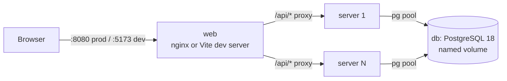
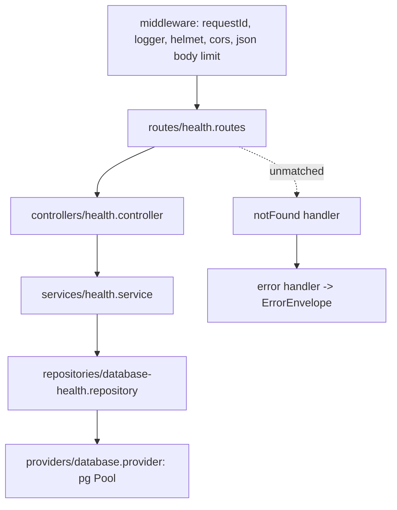

# Design

## Context

The repository contains only `openspec/` and the living docs; see proposal.md (Why). The stack, layering, Docker shape, error format, testing and quality targets are fixed by `openspec/config.yaml`; this design chooses how to meet them with the fewest moving parts. Requirements are in `specs/`; each element below names the RQ IDs it serves.

## Goals / Non-Goals

**Goals:**
- A runnable, healthy stack in dev and prod mode from one command.
- Base types, middleware and test harnesses that later features extend instead of copy.
- Quality gates (typecheck, lint, coverage, contract, accessibility, bundle size) that fail loudly from day one.

**Non-Goals:**
- Business tables, endpoints or screens.
- Idempotency-Key storage, write-endpoint rate limiting and request-body validation middleware: built with the first endpoint that needs them, so they are tested against real use.
- A client API layer: the shell makes no API calls, so the api client and its loading, empty and error states arrive with the first screen that fetches data.

## Architecture

### Before


### After



### Server layers (RQ-OPS-001, RQ-OPS-002)



### Folders

```
/shared   src/schemas/{error,health}.ts   src/openapi/build.ts   openapi/openapi.json (committed baseline)
/server   src/{config,logging,errors,middleware,routes,controllers,services,repositories,providers,db}/
          src/app.ts (createApp(deps))   src/main.ts (bootstrap)   migrations/*.sql
/client   src/{app,components,hooks,strings}/   index.html   vite.config.ts
root      compose.yaml  compose.override.yaml  compose.prod.yaml  .env.example  .nvmrc  eslint.config.js  vitest.config.ts (test.projects)  playwright.config.ts
/scripts  contract.ts  smoke-compose.ts  smoke-scale.ts  perf.ts      /e2e  shell.e2e.ts
```

`hooks/` and `api/` folders are created by the first feature that needs them, not now.

## Decisions

### D1. Shared Zod schemas first (RQ-API-002, RQ-OPS-001, RQ-OPS-002, RQ-API-008)

Defined in `/shared` before any server or client code:

```ts
export const ErrorCodeSchema = z.enum([
  "NOT_FOUND", "INVALID_JSON", "PAYLOAD_TOO_LARGE",
  "DATABASE_UNAVAILABLE", "SHUTTING_DOWN", "INTERNAL_ERROR",
]);
export const ErrorEnvelopeSchema = z.object({
  error: z.object({ code: ErrorCodeSchema, message: z.string(), requestId: z.string() }),
});
export const HealthResponseSchema = z.object({ status: z.literal("ok") });
export const ReadyResponseSchema = z.object({ status: z.literal("ready") });
```

New error codes are added to the enum later; adding enum values is allowed by the compatibility rules.

### D2. Error type hierarchy (RQ-API-001, RQ-API-002, RQ-API-004)

`AppError` (abstract: `code`, `httpStatus`, `message`) with `NotFoundError` (404), `BadRequestError` (400, `INVALID_JSON`), `PayloadTooLargeError` (413) and `ServiceUnavailableError` (503, `DATABASE_UNAVAILABLE` or `SHUTTING_DOWN`). One error-handler middleware maps any `AppError` to the envelope, maps body-parser errors (`entity.parse.failed`, `entity.too.large`) to the matching subclass, and turns everything else into 500 `INTERNAL_ERROR` after logging it. `ValidationError` and `ConflictError` are added with the first endpoint that raises them.

Unknown method on a known path returns 404 rather than 405: one catch-all handler and no per-route method lists. Alternative 405 with `Allow` header was rejected as extra code without a consumer.

### D3. Request ID and logging without a logging library (RQ-API-003, RQ-API-007)

Middleware reads `X-Request-Id`, checks it against `^[A-Za-z0-9._-]{1,128}$`, otherwise uses `crypto.randomUUID()`, stores it in `res.locals` and sets the response header. A small logger module writes `JSON.stringify({ time, level, msg, requestId, ...fields })` to stdout, with `LOG_LEVEL` filtering. The request logger records method, `req.path` (no query string), status and duration on `finish`. No body, query or header logging exists, so nothing needs redacting. Alternative pino was rejected: the needs fit in under 40 lines with platform APIs.

### D4. Configuration via Compose `env_file`, validated with Zod (RQ-OPS-003)

`server/src/config` holds an `EnvSchema` (Zod, server-only because it contains secrets) parsed once at startup. Errors are reported as `name: reason` from Zod issues; values are never printed. Compose passes `.env` through `env_file`, so no dotenv package is needed: the config.yaml rule "secrets via dotenv" is met by the dotenv-format `.env` file. A test parses `.env.example` and checks it has every schema key.

| Variable | Required | Default |
|----------|----------|---------|
| `DATABASE_URL` | yes | none |
| `PORT` | no | 3000 |
| `NODE_ENV` | no | `production` |
| `LOG_LEVEL` | no | `info` |
| `CORS_ORIGINS` | no | empty |
| `BODY_LIMIT_BYTES` | no | 102400 |
| `READY_DB_TIMEOUT_MS` | no | 2000 |
| `SHUTDOWN_GRACE_MS` | no | 10000 |
| `POSTGRES_USER`, `POSTGRES_PASSWORD`, `POSTGRES_DB` | yes (db service) | none |

These are technical defaults, not business values; they are listed as assumptions in `context.md`.

### D5. Migration runner without a migration library (RQ-OPS-004, RQ-OPS-005, RQ-OPS-006)

Data change: the runner creates its own bookkeeping table on first run (idempotent DDL, not a migration file):

```sql
CREATE TABLE IF NOT EXISTS schema_migrations (
  name        text        PRIMARY KEY,
  checksum    char(64)    NOT NULL,          -- SHA-256 hex of file bytes
  applied_at  timestamptz NOT NULL DEFAULT now()
);
```

Run order:
1. Take a dedicated connection and `SELECT pg_advisory_lock($1)` with the named constant `MIGRATION_LOCK_KEY`.
2. Read `server/migrations/*.sql`, sorted by name; compute SHA-256 with `node:crypto`.
3. Fail with `MIGRATION_MISSING` or `MIGRATION_CHECKSUM_MISMATCH` if any recorded row has no file or a different checksum.
4. For each pending file: `BEGIN; <file>; INSERT INTO schema_migrations ...; COMMIT;`, and on error `ROLLBACK` and exit 1.
5. `pg_advisory_unlock`, release the connection.

**Concurrency invariant:** each migration name is recorded at most once. It is enforced by the advisory lock, which serializes runs, and by the primary key on `name`, which rejects a duplicate insert even if the lock were bypassed. Session-level advisory locks are released by PostgreSQL when a session dies, which covers the "instance stops while holding the lock" scenario. Idempotency-Key storage is not needed: migrations are not an HTTP create endpoint. No indexes beyond the primary key are needed.

Alternative node-pg-migrate was rejected: it adds a dependency and its own conventions for about 60 lines of code.

### D6. OpenAPI from Zod without a generator (RQ-API-008)

`shared/src/openapi/build.ts` builds the document by hand-listing paths and using Zod 4's native `z.toJSONSchema()` for components, writing `shared/openapi/openapi.json`. `npm run contract:check` generates to a temp file and runs the pinned `tufin/oasdiff` Docker image: `oasdiff breaking --fail-on ERR <committed> <generated>`. When it passes, `npm run contract:update` overwrites the committed file. The first run has no previous document, so the generated one becomes the baseline. Alternative `@asteasolutions/zod-to-openapi` was rejected because Zod now exports JSON Schema itself.

### D7. Graceful shutdown (RQ-OPS-008, RQ-OPS-002)

`main.ts` handles SIGTERM by setting a `shuttingDown` flag (readiness then returns 503 `SHUTTING_DOWN`), calling `server.close()`, closing idle keep-alive sockets, and starting a `SHUTDOWN_GRACE_MS` timer. When `close` completes it ends the pg pool and exits 0. If the timer fires first it logs `forced shutdown`, destroys open sockets and exits 1. Compose sets `init: true` so the signal reaches Node, and `stop_grace_period` is above `SHUTDOWN_GRACE_MS`.

### D8. Readiness timeout (RQ-OPS-002)

`DatabaseHealthRepository.ping()` runs `SELECT 1` with the pg `query_timeout` set to `READY_DB_TIMEOUT_MS`, and the pool's `connectionTimeoutMillis` uses the same value, so a dead or slow database becomes `DATABASE_UNAVAILABLE` within the limit.

### D9. Client shell (RQ-WEB-001, RQ-WEB-002, RQ-WEB-004)

React + Vite + CSS Modules. `App` renders `<header>` (product name) and `<main>` inside an `ErrorBoundary` component. The fallback shows `strings.error.generic` and a native `<button>` that calls `location.reload()`. All text lives in `src/strings/en.ts`; the product name is a placeholder until the business provides it (`context.md` open item 2). The client uses no UI library, router or state library. A `check:bundle` script gzips the built entry chunk with `node:zlib` and fails at 200 kB or more, so no size-limit dependency is needed.

### D10. Web container and proxy (RQ-WEB-003, RQ-OPS-009)

Prod: a multi-stage Dockerfile builds the client with Node and serves `dist/` from pinned `nginxinc/nginx-unprivileged` (non-root, port 8080). `nginx.conf` defines `upstream api { server server:3000 resolve; keepalive 32; keepalive_timeout 4s; }` with `resolver 127.0.0.11 valid=10s` (open-source nginx 1.27.3+), so newly scaled or removed server instances are picked up, each resolved instance is a round-robin peer, and upstream connections are reused. `proxy_next_upstream error timeout` retries another instance. A variable `proxy_pass` was tried first and rejected: it cannot keep upstream connections alive, and the performance run exhausted ephemeral ports (502s under load). Dev: the `web` service runs the Vite dev server on 5173 with a `server.proxy` entry for `/api` to `http://server:3000`. Dev and prod images use separate tags (`:dev`, `:prod`) so switching modes never runs the other mode's last build; host ports are configurable with `WEB_DEV_PORT` and `WEB_PROD_PORT`.

### D11. Integration tests on a fresh PostgreSQL (all server RQ IDs)

A Vitest global setup connects to the compose `db` with an admin URL, creates `test_<random hex>` per test file and drops it afterwards, then runs migrations against it. This uses a fresh database without adding testcontainers. Concurrency tests for RQ-OPS-006 start 10 runner calls with `Promise.all`, each on its own pool.

### D12. Layering enforced by lint (all)

ESLint `no-restricted-imports` per folder (for example, `routes/**` may not import `repositories/**`; `shared/**` may not import `client` or `server`). This needs no extra plugin. Other lint rules: `@typescript-eslint/no-explicit-any` (error), `max-lines-per-function` (40), `no-magic-numbers` (ignoring 0 and 1, with tests exempt).

### Dependencies

| Package | Where | Why |
|---------|-------|-----|
| express 5 | server | HTTP framework from config.yaml |
| pg | server | PostgreSQL driver from config.yaml |
| zod 4 | shared, server | Validation from config.yaml; native JSON Schema export (D6) |
| helmet, cors | server | Security headers and CORS allowlist from config.yaml |
| react, react-dom | client | UI framework from config.yaml |
| vite, @vitejs/plugin-react | client (dev) | Build tool from config.yaml |
| typescript, typescript-eslint, eslint | root (dev) | Strict TS and lint |
| tsx | server (dev) | Hot-reloading TS execution in dev. Node's native type stripping was considered, but it rejects some TS syntax and workspace edge cases |
| vitest, @vitest/coverage-v8 | root (dev) | Unit tests and coverage from config.yaml |
| @testing-library/react, @testing-library/user-event, @testing-library/jest-dom, jsdom | client (dev) | Component tests by role from config.yaml |
| supertest | server (dev) | Integration tests from config.yaml |
| @playwright/test, @axe-core/playwright | root (dev) | End-to-end and accessibility tests from config.yaml |
| autocannon | root (dev) | Performance check from config.yaml |
| tufin/oasdiff (Docker image) | tooling | Contract gate from config.yaml |

All versions are pinned exactly (`save-exact=true` in `.npmrc`).

## Backward compatibility

Nothing public exists yet, so nothing can break. This change publishes `GET /api/v1/health`, `GET /api/v1/ready`, the error envelope and the env vars above; from now on they may only be extended (D6 enforces this for the API).

## Docker impact

- New services `db` (pinned `postgres:18.x-alpine`, named volume `db-data`, `pg_isready` healthcheck), `server` (multi-stage, pinned Node LTS alpine base for amd64 and arm64, user `node`, healthcheck `wget -qO- localhost:3000/api/v1/ready`), and `web` (prod: nginx-unprivileged on 8080; dev: Vite on 5173; healthcheck on `/`).
- `depends_on` with `condition: service_healthy`: server waits for db, web waits for server.
- `server` publishes no host port, so `--scale server=N` works.
- `compose.override.yaml` (dev): bind mounts for `/client`, `/server`, `/shared`, `tsx watch` and Vite HMR. `compose.prod.yaml`: built images only, `restart: unless-stopped`.
- No secrets in images; `.env` comes in through `env_file` and is git-ignored.

## Test plan

Test names follow "RQ-ID behaviour", laid out Given/When/Then.

| RQ ID | Level | Test |
|-------|-------|------|
| RQ-OPS-001 | Integration (Supertest) | 200 `{"status":"ok"}`; still 200 with the db pool pointed at a closed port |
| RQ-OPS-002 | Integration + unit | 200 ready on fresh db; 503 `DATABASE_UNAVAILABLE` on a closed port; timeout via a database provider stub that never answers, with fake timers; 503 `SHUTTING_DOWN` with the flag set |
| RQ-OPS-003 | Unit | Defaults applied; missing `DATABASE_URL` fails; bad value named but not echoed; `.env.example` covers the schema |
| RQ-OPS-004 | Integration | Order, skip-applied, rollback on bad SQL (fixture migration folders) |
| RQ-OPS-005 | Integration | Checksum mismatch and missing file both fail with their codes |
| RQ-OPS-006 | Concurrency | 10 parallel runs on fresh PostgreSQL: one execution, one row, no errors; lock released after a killed session |
| RQ-OPS-007 | Docker smoke | Script: `down -v`, `up --build --wait` in dev and prod, assert healthy and shell served |
| RQ-OPS-008 | Unit (in-process, injected exit) + Docker smoke | Slow in-flight request: exit 0 after completion; with a short grace: exit 1 within 1500 ms; `docker compose stop server` exits 0 |
| RQ-OPS-009 | Docker smoke | `--scale server=3`: 30/30 ready through web, logs from more than one container; stop one, 30/30 again |
| RQ-OPS-010 | Docker smoke | `down` then `up` keeps rows; `down -v` then `up` re-applies |
| RQ-API-001 | Integration | Unknown path and unknown method give 404 `NOT_FOUND` |
| RQ-API-002 | Unit + integration | Envelope parses with the shared schema; `INVALID_JSON`; thrown error gives 500 with no stack |
| RQ-API-003 | Unit + integration | Reuse valid ID; generate when missing; replace 200-char or spaced ID; ID present in captured log lines |
| RQ-API-004 | Integration | 102400 bytes accepted; 102401 bytes gives 413 |
| RQ-API-005 | Integration | Allowed, disallowed and default-empty origins |
| RQ-API-006 | Integration | Headers on 200 and 404 responses; no `X-Powered-By` |
| RQ-API-007 | Unit + integration | Log line shape; email and bearer token absent from captured logs |
| RQ-API-008 | Script test | Identical doc passes; fixture with a removed field fails |
| RQ-WEB-001 | Component + E2E | Banner and main by role; no console errors; missing asset gives 404 |
| RQ-WEB-002 | Component | Throwing child shows the fallback and button; button calls reload |
| RQ-WEB-003 | Docker smoke | `/api/v1/health` via the web port gives 200; with servers stopped gives 502 |
| RQ-WEB-004 | E2E + build | axe at 360 px and 1280 px; scrollWidth not above the viewport; keyboard focus on reload; bundle check |

Performance: autocannon against `/api/v1/health` and `/api/v1/ready` through `web`, asserting p95 < 500 ms. Coverage gates: 80% server and shared, 70% client.

## Risks / Trade-offs

- [nginx caches DNS, so scaled instances are not seen] → Use the Docker resolver with a short `valid` time and a variable `proxy_pass` (D10); covered by the RQ-OPS-009 smoke test.
- [Advisory lock key collides with a future feature's lock] → One named constant in a single module; later locks use other constants from the same module.
- [Hand-built OpenAPI paths drift from the Express routes] → An integration test asserts each documented path answers with a body that matches its schema.
- [Integration tests need Docker running] → `npm run test:integration` starts `db` with `docker compose up -d --wait db` first; unit tests run without Docker.
- [Placeholder product name could ship] → Tracked as open item 2 in `context.md`; QA checklist checks the strings module.
- [Node Active LTS changes during the project] → Pinned exactly in `.nvmrc` and the Dockerfile; upgrades are their own change.

## Migration Plan

Greenfield: deploy by running the prod compose command. The first start creates `schema_migrations`; no data exists to migrate. Rollback means stopping the stack; `down -v` removes all data.

## Open Questions

- Product name for the shell header (`context.md` open item 2). It changes only one string, not the specs, approach or tasks.
