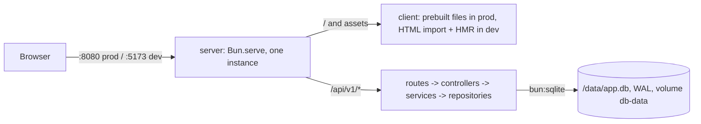
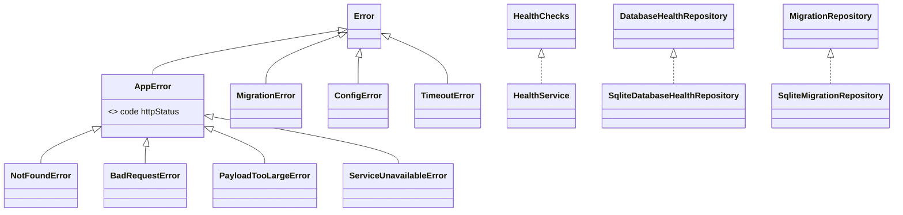
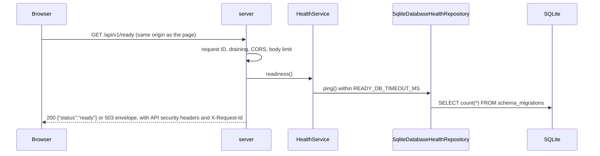

Architecture last reviewed: 2026-11-17, no change; migrate-to-bun-sqlite archived and its specs synced into openspec/specs.

# Project

## How to run

Prerequisites: Docker Desktop; Bun 1.4.2 (`"packageManager"` in `package.json`) for local tooling.

1. `copy .env.example .env` (Windows) or `cp .env.example .env`.
2. Dev with hot reload: `bun run dev` on the host, then open http://localhost:5173 (server restarts on save, client hot-reloads; database in `.data/app.db`). Dev in Docker: `docker compose up --build` serves the same on http://localhost:5173, but on Windows and macOS hosts Bun's file watcher does not see changes through bind mounts (Bun has no polling mode), so restart the container after edits there; on Linux hosts it reloads.
3. Prod: `docker compose -f compose.yaml -f compose.prod.yaml up --build`, then open http://localhost:8080.
4. Reset the database: `docker compose down -v`.
5. Port already taken? Set `WEB_DEV_PORT` or `WEB_PROD_PORT` in `.env`.

| Command | What it runs |
|---------|--------------|
| `bun install` | Workspaces `shared`, `server`, `client` and root tooling |
| `bun run check` | Typecheck, lint, all workspace tests with coverage gates, contract check, bundle check |
| `bun run test` | `bun test` in every workspace (no Docker needed) |
| `bun run contract:check` / `contract:update` | oasdiff (Docker) against `shared/openapi/openapi.json` |
| `bun run smoke:compose` | Docker smoke test (destroys the local stack and its volume) |
| `bun run test:e2e` / `test:perf` | Playwright + axe in its Docker image, and autocannon, against the prod stack |

## Status

Done and archived: `migrate-to-bun-sqlite`. Done and archived: `setup-project-foundation`. Waiting for business scope: `add-instant-booking`.

Performance (2026-11-17, prod container on Windows + Docker Desktop, 10 connections, 10 s, autocannon on Bun against 127.0.0.1:8080):

| Endpoint | Requests | p50 | p97.5 (upper bound for p95) | p99 | Errors |
|----------|----------|-----|-----------------------------|-----|--------|
| `GET /api/v1/health` | 60,139 | 1 ms | 3 ms | 3 ms | 0 |
| `GET /api/v1/ready` | 55,184 | 1 ms | 3 ms | 4 ms | 0 |

Initial client JavaScript: 65.4 kB gzipped (limit 200 kB).

## Architecture

### System overview



### Containers

| Service | Image | Role | Port | Healthcheck |
|---------|-------|------|------|-------------|
| server | `server/Dockerfile` → `app-server:dev` / `app-server:prod` (`oven/bun:1.4.2-alpine`, amd64 + arm64) | API under `/api/v1`, client, SQLite file in `/data`; user `bun`, `init: true`, stop grace 15 s | container 3000; host `${WEB_DEV_PORT:-5173}` dev, `${WEB_PROD_PORT:-8080}` prod | `GET /api/v1/ready` |
| e2e (profile `e2e`) | `e2e/Dockerfile` (`mcr.microsoft.com/playwright:v1.65.1-noble`) | Playwright + axe against `http://server:3000` | none | none |

### Layers and folders

```
/shared   src/schemas/      Zod schemas and types (error envelope, health); exported as TypeScript source
          src/openapi/      route table + OpenAPI builder; openapi/openapi.json is the committed baseline
/server   src/config/       env schema and loader (DATABASE_PATH, ...)
          src/logging/      JSON-lines logger
          src/errors/       AppError hierarchy, MigrationError
          src/http/         request ID, logging, API security headers, CORS, draining, JSON body limit, error responses, static files
          src/routes/ -> src/controllers/ -> src/services/ -> src/repositories/ + src/providers/
          src/lifecycle/    LifecycleState, graceful shutdown (server.stop)
          src/lib/          withTimeout
          src/app.ts        createApp(deps): API fetch handler and route table
          src/main.ts       bootstrap: config -> open SQLite -> migrations -> Bun.serve -> SIGTERM/SIGINT
          migrations/       forward-only SQL files (0001_baseline.sql)
          test/             fresh-SQLite-file harness, migration subprocess runner, factories, in-memory doubles
/client   index.html  src/app/ src/components/ src/strings/ src/styles.css    (hooks/ and api/ arrive with the first data screen)
/scripts  contract.ts, docker.ts, smoke-compose.ts, perf.ts
/e2e      own package: Playwright + axe tests and Dockerfile
```

Rules (enforced by ESLint `no-restricted-imports`, tests exempt): server calls only go down routes -> controllers -> services -> repositories / providers; client components -> hooks -> api; `/shared` imports from neither side. SQL lives only in `server/src/repositories/` (plus the PRAGMAs in the SQLite provider).

### Type hierarchy



### Main flow

No business flow yet. Technical flow for readiness:



### API surface

Unchanged by the Bun move:

| Method | Path | Success | Errors |
|--------|------|---------|--------|
| GET | `/api/v1/health` | 200 `{"status":"ok"}` | none |
| GET | `/api/v1/ready` | 200 `{"status":"ready"}` | 503 `DATABASE_UNAVAILABLE`, `SHUTTING_DOWN` |
| any | other `/api/v1/*` | none | 404 `NOT_FOUND`, 400 `INVALID_JSON`, 413 `PAYLOAD_TOO_LARGE`, 500 `INTERNAL_ERROR` |

Errors: `{"error":{"code","message","requestId"}}`. API responses carry `X-Request-Id`, nosniff, HSTS and `Content-Security-Policy: default-src 'none'`; prod page responses carry `default-src 'self'; base-uri 'self'; object-src 'none'; frame-ancestors 'none'`.

### Data model

```sql
schema_migrations (name TEXT PRIMARY KEY, checksum TEXT NOT NULL CHECK (length(checksum) = 64),
                   applied_at TEXT NOT NULL DEFAULT (strftime('%Y-%m-%dT%H:%M:%fZ','now'))) STRICT
```

SQLite file `/data/app.db` in WAL mode (`busy_timeout` = `READY_DB_TIMEOUT_MS`, `foreign_keys` on). Each migration file runs in its own `BEGIN IMMEDIATE` transaction that also re-checks what is applied, so concurrent processes apply each file exactly once.

### Scaling and state

One server instance: SQLite allows one writer per file (RQ-OPS-009 retired 2026-11-17). The server keeps no request or session state beyond the shutting-down flag, so moving to a networked database later could bring horizontal scaling back. bun:sqlite is synchronous: on the main connection, a lock held by another process can block the event loop for up to `READY_DB_TIMEOUT_MS` (its busy timeout). Readiness avoids this with its own connection (`busy_timeout = 0`) that retries asynchronously every 25 ms until the timeout.

### Decisions

See [context.md decisions log](context.md#decisions-log) and the [migrate-to-bun-sqlite design](openspec/changes/archive/2026-11-17-migrate-to-bun-sqlite/design.md#decisions) (D1 to D10); earlier decisions are in the archived [foundation design](openspec/changes/archive/2026-11-17-setup-project-foundation/design.md#decisions).
